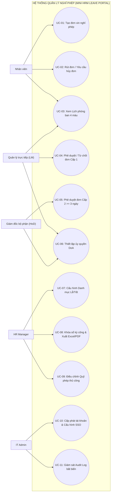
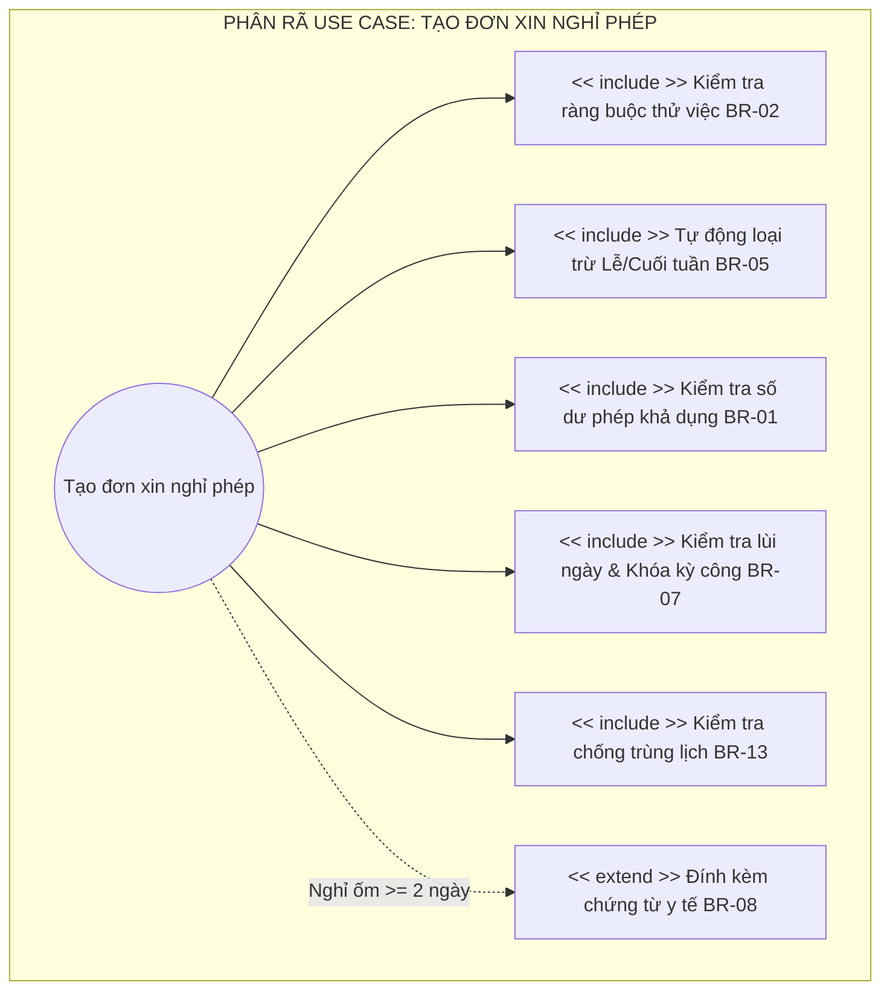
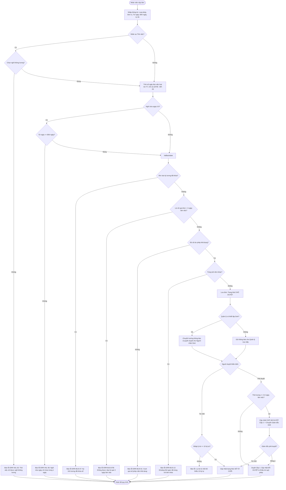

# TÀI LIỆU ĐẶC TẢ YÊU CẦU PHẦN MỀM
### (Software Requirement Specification – SRS)
## HỆ THỐNG QUẢN LÝ NGHỈ PHÉP NỘI BỘ (MINI HRM LEAVE PORTAL)
**Phiên bản:** 3.3  
**Chi tiết hoá URD:** URD_Leave_Management_System v3.0  
**Người biên soạn:** Nhóm Đảm bảo Chất lượng Phần mềm (SQA Team) – Khóa BCSE2023  
**Địa điểm & Thời gian:** TP. Hồ Chí Minh, tháng 10, năm 2026  

---

| Biên soạn bởi | Kiểm thử bởi | Duyệt bởi | Phiên bản |
| :--- | :--- | :--- | :---: |
| **BA Team Lead**<br>Nguyễn Văn An | **QA / Test Lead**<br>Trần Thị Mai | **Product Owner / Giám đốc**<br>Lê Khắc Hoàng | **3.3** |
| Ngày: 08/10/2026 | Ngày: 10/10/2026 | Ngày: 12/10/2026 | |

---

## Mục lục
- [Mục lục](#mục-lục)
- [Danh mục hình ảnh, bảng biểu](#danh-mục-hình-ảnh-bảng-biểu)
- [1 Giới thiệu](#1-giới-thiệu)
  - [1.1 Mục đích](#11-mục-đích)
  - [1.2 Phạm vi](#12-phạm-vi)
  - [1.3 Từ điển thuật ngữ](#13-từ-điển-thuật-ngữ)
  - [1.4 Tài liệu tham khảo](#14-tài-liệu-tham-khảo)
  - [1.5 Quy ước mã yêu cầu](#15-quy-ước-mã-yêu-cầu)
- [2 Các yêu cầu chức năng](#2-các-yêu-cầu-chức-năng)
  - [2.1 Các tác nhân](#21-các-tác-nhân)
  - [2.2 Các chức năng của hệ thống](#22-các-chức-năng-của-hệ-thống)
  - [2.3 Biểu đồ use case tổng quan](#23-biểu-đồ-use-case-tổng-quan)
  - [2.4 Biểu đồ use case phân rã](#24-biểu-đồ-use-case-phân-rã)
  - [2.5 Quy trình nghiệp vụ](#25-quy-trình-nghiệp-vụ)
    - [2.5.1 Quy trình Tạo và Phê duyệt đơn xin nghỉ phép](#251-quy-trình-tạo-và-phê-duyệt-đơn-xin-nghỉ-phép)
    - [2.5.2 Quy trình Ủy quyền phê duyệt (DoA) & Chuyển hướng thông báo](#252-quy-trình-ủy-quyền-phê-duyệt-doa--chuyển-hướng-thông-báo)
  - [2.6 Đặc tả các use case](#26-đặc-tả-các-use-case)
    - [2.6.1 Use Case 1: UC-01 – Tạo đơn xin nghỉ phép](#261-use-case-1-uc-01--tạo-đơn-xin-nghỉ-phép)
    - [2.6.2 Use Case 2: UC-02 – Phê duyệt / Từ chối đơn xin nghỉ phép đa cấp](#262-use-case-2-uc-02--phê-duyệt--từ-chối-đơn-xin-nghỉ-phép-đa-cấp)
    - [2.6.3 Use Case 3: UC-03 – Thiết lập ủy quyền phê duyệt (DoA)](#263-use-case-3-uc-03--thiết-lập-ủy-quyền-phê-duyệt-doa)
    - [2.6.4 Use Case 4: UC-04 – Khóa sổ kỳ tính lương và Điều chỉnh quỹ phép](#264-use-case-4-uc-04--khóa-sổ-kỳ-tính-lương-và-điều-chỉnh-quỹ-phép)
  - [2.7 Bảng mã lỗi](#27-bảng-mã-lỗi)
  - [2.8 Ma trận truy vết yêu cầu](#28-ma-trận-truy-vết-yêu-cầu)
  - [2.9 Câu hỏi gửi bộ phận nghiệp vụ](#29-câu-hỏi-gửi-bộ-phận-nghiệp-vụ)
- [3 Các yêu cầu phi chức năng](#3-các-yêu-cầu-phi-chức-năng)
  - [3.1 Giao diện người dùng](#31-giao-diện-người-dùng)
  - [3.2 Hiệu năng](#32-hiệu-năng)
  - [3.3 Tính bảo mật](#33-tính-bảo-mật)
  - [3.4 Ràng buộc](#34-ràng-buộc)

---

## Danh mục hình ảnh, bảng biểu

* **Hình ảnh:**
  - Hình 2-1: Biểu đồ use case tổng quan
  - Hình 2-2: Biểu đồ use case phân rã
  - Hình 2-3: Biểu đồ hoạt động của quy trình Tạo và Phê duyệt đơn nghỉ phép
  - Hình 2-4: Giao diện màn hình Tạo đơn xin nghỉ phép (`SCR-EMP-01`)
  - Hình 2-5: Giao diện màn hình Cổng Quản lý & Phê duyệt (`SCR-MGR-01`)
  - Hình 2-6: Giao diện màn hình Cổng Quản trị Nhân sự & Kỳ công (`SCR-ADM-01`)

* **Bảng biểu:**
  - Bảng 1-1: Từ điển thuật ngữ
  - Bảng 1-2: Quy ước mã yêu cầu
  - Bảng 2-1: Danh sách các tác nhân
  - Bảng 2-2a: Đặc tả chức năng UC-01 (Tạo đơn xin nghỉ phép)
  - Bảng 2-3a: Dữ liệu chức năng UC-01 (Tạo đơn xin nghỉ phép)
  - Bảng 2-2b: Đặc tả chức năng UC-02 (Phê duyệt / Từ chối đơn xin nghỉ phép)
  - Bảng 2-3b: Dữ liệu chức năng UC-02 (Duyệt / Từ chối đơn)
  - Bảng 2-2c: Đặc tả chức năng UC-03 (Thiết lập ủy quyền DoA)
  - Bảng 2-3c: Dữ liệu chức năng UC-03 (Thiết lập DoA)
  - Bảng 2-2d: Đặc tả chức năng UC-04 (Khóa sổ kỳ công & Điều chỉnh quỹ phép)
  - Bảng 2-3d: Dữ liệu chức năng UC-04 (Khóa kỳ công & Chỉnh phép)
  - Bảng 2-4: Bảng mã lỗi của hệ thống
  - Bảng 2-5: Ma trận truy vết yêu cầu (Traceability Matrix)
  - Bảng 2-6: Danh sách câu hỏi gửi bộ phận nghiệp vụ
  - Bảng 3-1: Các yêu cầu hiệu năng

---

## 1 Giới thiệu

### 1.1 Mục đích
Tài liệu này chi tiết hóa tài liệu Yêu cầu Người dùng **URD_Leave_Management_System phiên bản 3.0**, đóng vai trò là căn cứ chuẩn (*Ground Truth / Baseline*) phục vụ các hoạt động thiết kế kiến trúc, lập trình phát triển và kiểm thử phần mềm (**Software Quality Assurance - SQA**) cho dự án **Hệ thống Quản lý Nghỉ phép Nội bộ (Mini HRM Leave Portal)**.  
Tài liệu được sử dụng bởi:
1. **Đội ngũ Lập trình viên (Developers):** Hiện thực hóa chính xác các luồng nghiệp vụ, công thức tính toán và ràng buộc toàn vẹn dữ liệu.
2. **Đội ngũ Kiểm thử viên (Testers / QA):** Thiết kế Ma trận bao phủ kiểm thử (RTM), xây dựng kịch bản kiểm thử biên, phân vùng tương đương và thực thi kiểm thử hồi quy.
3. **Bộ phận Nghiệp vụ (HR Manager & IT Admin):** Đối soát nghiệm thu tính năng và đảm bảo tuân thủ nguyên tắc Phân tách Trách nhiệm (Separation of Duties - SoD).

### 1.2 Phạm vi
Hệ thống là nền tảng quản trị vắng mặt tập trung đa nền tảng (Web & Mobile Responsive PWA), tự động hóa toàn diện vòng đời xin - duyệt - chuyển đổi ngày nghỉ trong doanh nghiệp. Hệ thống bao gồm 3 phân hệ chính:
1. **Cổng Nghiệp vụ Nội bộ (HR Portal - URL: `/employee` & `/manager`):** Dành cho Nhân viên (thử việc/chính thức), Quản lý trực tiếp (Line Manager) và Giám đốc bộ phận (Head of Department) thực hiện nộp đơn, xem lịch trực quan 4 màu, duyệt đơn 2 cấp và ủy quyền duyệt (DoA).
2. **Cổng Quản trị Vận hành Nhân sự (HR Manager Portal - URL: `/admin`):** Quản lý hồ sơ nhân sự, danh mục ngày Lễ/Tết quốc gia, khóa sổ kỳ tính lương ngày 25 hàng tháng và xuất báo cáo tiền lương chuẩn Excel/PDF.
3. **Cổng Quản trị Kỹ thuật & Giám sát An toàn (IT Admin Portal - URL: `/admin` & System Config):** Cấp phát tài khoản gốc, cấu hình SSO (Google/Microsoft 365) và giám sát độc lập tính bất biến của bảng Audit Log.

### 1.3 Từ điển thuật ngữ

| Thuật ngữ | Giải thích |
| :--- | :--- |
| **SRS** | Software Requirements Specification (Tài liệu đặc tả yêu cầu phần mềm). |
| **URD** | User Requirements Document (Tài liệu yêu cầu người dùng). |
| **Line Manager (LM)** | Quản lý trực tiếp (Người duyệt Cấp 1 đối với các đơn nghỉ phép của nhóm). |
| **Head of Department (HoD)** | Giám đốc bộ phận / Trưởng khối (Người duyệt Cấp 2 đối với đơn dài ngày $\ge 3$ ngày làm việc). |
| **HR Manager** | Trưởng phòng / Chuyên viên Nhân sự (Business Admin - Phụ trách công lương, danh mục Lễ/Tết và hồ sơ). |
| **IT Admin** | Quản trị viên Hệ thống (System Admin - Quản lý tài khoản gốc, SSO và giám sát Audit Log). |
| **SoD** | Separation of Duties (Nguyên tắc phân tách trách nhiệm giữa vận hành nghiệp vụ HR và an toàn kỹ thuật IT). |
| **DoA** | Delegation of Authority (Cơ chế ủy quyền phê duyệt tạm thời kèm chuyển hướng thông báo). |
| **Payroll Lock** | Mốc khóa sổ kỳ tính lương ngày 25 hàng tháng, chặn nộp lùi ngày vào kỳ đã chốt công. |
| **Public Holidays** | Danh mục các ngày Lễ/Tết quốc gia theo luật định (tự động loại trừ, không trừ phép năm). |
| **Probationary Employee** | Nhân sự đang thử việc (chỉ được xin nghỉ không hưởng lương). |
| **Accrual & Carry-over** | Tích lũy phép định kỳ (+1 ngày/tháng) và chuyển phép năm cũ (hạn chót sử dụng hết ngày 31/03). |
| **Audit Log Trail** | Nhật ký kiểm toán bất biến (Append-only) ghi lại toàn bộ thao tác can thiệp dữ liệu hệ thống. |

*Bảng 1-1: Từ điển thuật ngữ*

### 1.4 Tài liệu tham khảo
1. *Bộ luật Lao động nước Cộng hòa Xã hội Chủ nghĩa Việt Nam năm 2019* (Quy định về thời giờ nghỉ ngơi và nghỉ phép năm).
2. *URD_Leave_Management_System v3.0* – Tài liệu yêu cầu người dùng nghiệm thu nội bộ.
3. *Tiêu chuẩn ISO/IEC/IEEE 29148:2018* – Systems and software engineering — Life cycle processes — Requirements engineering.
4. *OWASP Top 10 API Security Risks* – Các nguyên tắc bảo mật kiểm soát truy cập đối tượng (BOLA/IDOR).

### 1.5 Quy ước mã yêu cầu

| Tiền tố | Loại yêu cầu | Ví dụ | Diễn giải |
| :--- | :--- | :--- | :--- |
| **FR** | Yêu cầu chức năng (*Functional Requirement*) | `FR-LEAVE-01` | Chức năng tạo đơn xin nghỉ phép. |
| **VAL** | Quy tắc kiểm tra dữ liệu (*Validation Rule*) | `VAL-DATE-01` | Kiểm tra Đến ngày $\ge$ Từ ngày. |
| **DIS** | Điều kiện hiển thị / Khóa (*Display / UI Rule*) | `DIS-PROB-01` | Nhân sự thử việc chỉ hiển thị tùy chọn "Nghỉ không lương". |
| **BUS** | Quy tắc nghiệp vụ cốt lõi (*Business Rule*) | `BUS-RULE-05` | Tự động loại trừ Thứ 7, CN và ngày Lễ/Tết. |
| **NFR** | Yêu cầu phi chức năng (*Non-Functional Req*) | `NFR-PERF-01` | Thời gian phản hồi API $\le 500$ ms. |
| **ERR** | Mã lỗi và thông báo (*Error Code*) | `ERR-LEAVE-001`| Số ngày xin nghỉ vượt quá số dư khả dụng. |

*Bảng 1-2: Quy ước mã yêu cầu*

---

## 2 Các yêu cầu chức năng

### 2.1 Các tác nhân

| Tác nhân | Vai trò trong hệ thống |
| :--- | :--- |
| **Nhân viên Thử việc (Probationary)** | Nhân sự đang trong thời gian thử việc; chỉ được phép nộp đơn xin nghỉ không hưởng lương; không được duyệt đơn. |
| **Nhân viên Chính thức (Official)** | Nhân sự chính thức; nộp đơn 5 loại phép hưởng lương; theo dõi lịch phòng ban 4 màu; rút đơn hoặc gửi yêu cầu hủy đơn đã duyệt. |
| **Quản lý trực tiếp (Line Manager - LM)** | Phê duyệt đơn $< 3$ ngày làm việc; duyệt cấp 1 cho đơn $\ge 3$ ngày; thiết lập ủy quyền DoA; xác nhận yêu cầu hủy đơn của cấp dưới. |
| **Giám đốc bộ phận (Head of Dept - HoD)** | Phê duyệt Cấp 2 (chung cuộc) cho các đơn nghỉ dài ngày $\ge 3$ ngày làm việc; giám sát vắng mặt toàn bộ phận; ủy quyền cấp phó. |
| **HR Manager (Business Admin)** | Quản lý danh mục Lễ/Tết quốc gia; cập nhật hợp đồng nhân sự; thực hiện khóa sổ kỳ tính lương ngày 25; xuất báo cáo tiền lương Excel/PDF; điều chỉnh quỹ phép thủ công (+ lưu Audit Log). |
| **IT Admin (System Admin)** | Khởi tạo tài khoản gốc; cấu hình xác thực tập trung SSO; giám sát tính toàn vẹn và bất biến của bảng Audit Log; không tham gia duyệt đơn hay chốt công lương. |

*Bảng 2-1: Danh sách các tác nhân*

### 2.2 Các chức năng của hệ thống
Hệ thống bao gồm 4 phân hệ chức năng chính:
1. **Phân hệ Nghiệp vụ Nghỉ phép (Employee Portal):** Xem số dư 4 chỉ số quỹ phép, tạo đơn nghỉ phép tối ưu chuẩn 4-Clicks, xem Lịch phòng ban 4 màu (🟢, 🔴, 🟡, 🔵), rút đơn chờ duyệt, yêu cầu hủy đơn đã duyệt.
2. **Phân hệ Phê duyệt & Ủy quyền (Manager Portal):** Xét duyệt luồng đa cấp (Cấp 1 LM $\rightarrow$ Cấp 2 Director), từ chối đơn bắt buộc lý do $\ge 10$ ký tự, thiết lập ủy quyền DoA kèm cơ chế tự động chuyển hướng thông báo, xử lý yêu cầu hủy đơn.
3. **Phân hệ Quản trị Vận hành Nhân sự (HR Manager Portal):** Cập nhật phân loại hợp đồng (Thử việc/Chính thức), quản lý danh mục Lễ/Tết, khóa sổ kỳ công ngày 25 hàng tháng, xuất báo cáo tiền lương Excel (.csv/.xlsx) và PDF, điều chỉnh quỹ phép có kiểm soát.
4. **Phân hệ Quản trị Kỹ thuật & An toàn (IT Admin Portal):** Cấp phát tài khoản gốc, cấu hình tích hợp Google/Microsoft SSO, kiểm soát an toàn và tính bất biến của bảng nhật ký kiểm toán (Audit Log Trail).

### 2.3 Biểu đồ use case tổng quan


*Hình 2-1: Biểu đồ use case tổng quan*

### 2.4 Biểu đồ use case phân rã


*Hình 2-2: Biểu đồ use case phân rã*

### 2.5 Quy trình nghiệp vụ

#### 2.5.1 Quy trình Tạo và Phê duyệt đơn xin nghỉ phép


*Hình 2-3: Biểu đồ hoạt động của quy trình Tạo và Phê duyệt đơn nghỉ phép*

#### 2.5.2 Quy trình Ủy quyền phê duyệt (DoA) & Chuyển hướng thông báo
1. Quản lý trực tiếp (hoặc Giám đốc) truy cập tab "Ủy quyền của tôi", chọn nhân sự nhận ủy quyền (cùng cấp hoặc cấp phó), khoảng thời gian hiệu lực và lý do ủy quyền.
2. Hệ thống kích hoạt DoA: Tự động gửi thông báo xác nhận tức thì cho Người được ủy quyền.
3. Trong suốt thời gian DoA có hiệu lực: Toàn bộ thông báo phát sinh từ cấp dưới sẽ tự động được chuyển hướng (route) đến hộp thư và chuông thông báo của Người nhận ủy quyền (đồng thời CC cho Người ủy quyền).
4. Mọi thao tác duyệt đơn của Người nhận ủy quyền đều được ghi vết minh bạch: *"Phê duyệt bởi [B] theo ủy quyền của [A]"*.

---

### 2.6 Đặc tả các use case

#### 2.6.1 Use Case 1: UC-01 – Tạo đơn xin nghỉ phép

| Mục | Nội dung chi tiết |
| :--- | :--- |
| **Mã Use case** | `UC-LEAVE-01` |
| **Tên Use case** | Tạo đơn xin nghỉ phép |
| **Tác nhân** | Nhân viên Thử việc, Nhân viên Chính thức, Quản lý, Giám đốc |
| **Mô tả** | Cho phép nhân sự tạo đơn xin nghỉ phép mới theo quy chuẩn tối giản 4-Clicks, tự động tính trừ ngày làm việc loại trừ cuối tuần & Lễ/Tết, kiểm tra số dư và ràng buộc khóa kỳ công. |
| **Sự kiện kích hoạt**| Nhân viên nhấp chuột vào ngày trên Lịch hoặc truy cập form tạo đơn tại `/employee`. |
| **Tiền điều kiện** | Nhân viên đã đăng nhập thành công vào hệ thống. |
| **Luồng sự kiện chính (Thành công)** | **STT** \| **Thực hiện bởi** \| **Hành động**<br>1. Nhân viên chọn ngày bắt đầu và kết thúc trên Lịch.<br>2. Hệ thống tự động tính số ngày làm việc thực tế (`workingDays`), loại trừ Thứ 7, Chủ Nhật và các ngày Lễ/Tết quốc gia (`BR-05`).<br>3. Nhân viên chọn Loại phép và Đơn vị nghỉ (Cả ngày / Nửa ngày sáng / Nửa ngày chiều).<br>4. Nhân viên nhập lý do nghỉ phép (hoặc chọn gợi ý nhanh). Nếu là nghỉ ốm $\ge 2$ ngày, đính kèm tệp chứng từ y tế $\le 5$ MB (`BR-08`).<br>5. Nhân viên nhấn nút **"Nộp đơn xin nghỉ phép"**.<br>6. Hệ thống kiểm tra hợp lệ: Không thuộc kỳ công đã khóa (`BR-07`), lùi ngày $\le 3$ ngày làm việc, đủ số dư phép khả dụng (`BR-01`), không trùng lịch cá nhân (`BR-13`).<br>7. Hệ thống lưu bản ghi với trạng thái `PENDING` (hoặc `PENDING_DIRECTOR` nếu $\ge 3$ ngày), phát thông báo tới Quản lý trực tiếp (hoặc người nhận DoA). |
| **Luồng sự kiện thay thế** | **STT** \| **Thực hiện bởi** \| **Hành động**<br>4a. *Nhân sự thử việc chọn phép có lương:* Hệ thống chặn và báo lỗi `ERR-VAL-02`.<br>6a. *Đến ngày nhỏ hơn Từ ngày:* Hệ thống báo lỗi `ERR-VAL-05`.<br>6b. *Nghỉ nửa ngày nhưng Từ ngày $\ne$ Đến ngày:* Hệ thống báo lỗi `ERR-VAL-06`.<br>6c. *Khoảng ngày rơi vào kỳ tính lương đã khóa:* Hệ thống chặn nộp đơn và báo lỗi `ERR-BUS-07`.<br>6d. *Nộp lùi ngày quá 3 ngày làm việc:* Hệ thống báo lỗi `ERR-BUS-07B`.<br>6e. *Số ngày nghỉ vượt quá số phép năm khả dụng:* Hệ thống báo lỗi `ERR-BUS-01`.<br>6f. *Nghỉ ốm $\ge 2$ ngày thiếu tệp chứng từ:* Hệ thống báo lỗi `ERR-BUS-08`.<br>6g. *Khoảng ngày nghỉ giao thoa với đơn đang chờ/đã duyệt:* Hệ thống báo lỗi `ERR-BUS-13`. |
| **Hậu điều kiện** | Đơn được tạo thành công với trạng thái `CHỜ DUYỆT`. Lịch phòng ban cập nhật trạng thái giữ chỗ tạm thời. |
| **Quy tắc nghiệp vụ**| `BUS-RULE-01`, `BUS-RULE-02`, `BUS-RULE-05`, `BUS-RULE-06`, `BUS-RULE-07`, `BUS-RULE-08`, `BUS-RULE-13`. |
| **Yêu cầu phi chức năng**| Chuẩn 4-Clicks (`NFR-02`), Thời gian phản hồi $\le 500$ ms (`NFR-PERF-01`). |
| **Truy vết URD** | `URD-LEAVE-REQ-01`, `URD-LEAVE-REQ-02`. |

*Bảng 2-2a: Đặc tả chức năng UC-01*

* **Dữ liệu đầu vào của Use Case UC-01:**

| STT | Trường dữ liệu | Mô tả | Bắt buộc? | Điều kiện hợp lệ | Ví dụ |
| :---: | :--- | :--- | :---: | :--- | :--- |
| 1 | `leaveType` | Loại nghỉ phép | Có | Thuộc enum: `ANNUAL`, `SICK`, `UNPAID`, `MATERNITY_PATERNITY`, `WEDDING_BEREAVEMENT`. Với nhân sự thử việc, chỉ hợp lệ giá trị `UNPAID`. | `ANNUAL` |
| 2 | `leaveUnit` | Đơn vị nghỉ | Có | Thuộc enum: `FULL_DAY`, `MORNING`, `AFTERNOON`. | `FULL_DAY` |
| 3 | `startDate` | Ngày bắt đầu nghỉ | Có | Chuỗi ISO Date hợp lệ (`YYYY-MM-DD`). Không thuộc kỳ công đã khóa ($\le 25$). Lùi ngày $\le 3$ ngày làm việc. | `2026-10-15` |
| 4 | `endDate` | Ngày kết thúc nghỉ | Có | Chuỗi ISO Date hợp lệ (`YYYY-MM-DD`). Phải $\ge startDate$. Nếu nghỉ nửa ngày thì phải `== startDate`. | `2026-10-16` |
| 5 | `reason` | Lý do xin nghỉ | Có | Chuỗi ký tự, độ dài từ 5 đến 500 ký tự. | `Giải quyết công việc gia đình cá nhân` |
| 6 | `file` | Tệp chứng từ y tế | Tùy chọn / Bắt buộc | Bắt buộc khi `leaveType == SICK` và `workingDays >= 2.0`. Định dạng: `.pdf, .jpg, .jpeg, .png`. Dung lượng $\le 5.0$ MB. | `giay_ra_vien.pdf` |

*Bảng 2-3a: Dữ liệu chức năng UC-01*

```text
+-----------------------------------------------------------------------------------------+
| [SCR-EMP-01] MÀN HÌNH TẠO ĐƠN XIN NGHỈ PHÉP (4-CLICKS LEAVE FORM)                      |
+-----------------------------------------------------------------------------------------+
| [Quỹ phép cấp: 12.0 ngày]  [Tồn năm cũ (hạn 31/03): 3.0 ngày]  [Khả dụng còn lại: 15.0]  |
+-----------------------------------------------------------------------------------------+
| 1. Chọn ngày nghỉ:                                                                     |
|    Từ ngày: [ 2026-10-15 ] (Click 1)     Đến ngày: [ 2026-10-16 ]                       |
|    => Số ngày làm việc tính trừ: 2.0 ngày (Đã loại trừ T7, CN và ngày Lễ)                |
+-----------------------------------------------------------------------------------------+
| 2. Hình thức & Đơn vị:                                                                  |
|    Loại phép: [* Phép năm (Annual Leave)          v] (Click 2)                          |
|    Đơn vị:    (o) Cả ngày (1.0d)   ( ) Nửa ngày sáng (0.5d)   ( ) Nửa ngày chiều (0.5d)  |
+-----------------------------------------------------------------------------------------+
| 3. Lý do xin nghỉ phép:                                                                 |
|    [ Giải quyết công việc việc cá nhân...                                ] (Click 3)    |
|    Chứng từ y tế: [ Chọn file (.pdf, .png <= 5MB) ] (Tùy chọn)                          |
+-----------------------------------------------------------------------------------------+
| 4. Hoàn tất:                                                                            |
|    [               >>> NỘP ĐƠN XIN NGHỈ PHÉP (Click 4) <<<               ]              |
+-----------------------------------------------------------------------------------------+
```
*Hình 2-4: Giao diện màn hình Tạo đơn xin nghỉ phép (`SCR-EMP-01`)*

---

#### 2.6.2 Use Case 2: UC-02 – Phê duyệt / Từ chối đơn xin nghỉ phép đa cấp

| Mục | Nội dung chi tiết |
| :--- | :--- |
| **Mã Use case** | `UC-LEAVE-02` |
| **Tên Use case** | Phê duyệt / Từ chối đơn xin nghỉ phép |
| **Tác nhân** | Quản lý trực tiếp (LM), Giám đốc bộ phận (HoD), Người nhận ủy quyền DoA |
| **Mô tả** | Xử lý xét duyệt đơn xin nghỉ phép theo luồng đa cấp thời lượng: Đơn $< 3$ ngày làm việc hoàn tất sau 1 cấp duyệt; Đơn $\ge 3$ ngày làm việc yêu cầu 2 cấp duyệt (LM $\rightarrow$ HoD). |
| **Sự kiện kích hoạt**| Người duyệt truy cập Cổng Quản lý (`/manager`) và chọn một đơn cần xử lý. |
| **Tiền điều kiện** | Tài khoản có vai trò `MANAGER` hoặc `DIRECTOR`, hoặc đang nắm giữ ủy quyền DoA hợp lệ. Đơn đang ở trạng thái `PENDING` hoặc `PENDING_DIRECTOR`. |
| **Luồng sự kiện chính (Thành công)** | **STT** \| **Thực hiện bởi** \| **Hành động**<br>1. Người duyệt xem chi tiết đơn: Họ tên nhân viên, loại hợp đồng, loại phép, thời gian, số ngày tính công, tệp chứng từ và lý do.<br>2. Người duyệt nhấn nút **"Duyệt đơn"**.<br>3a. *Nếu đơn $< 3.0$ ngày:* Hệ thống cập nhật trạng thái đơn thành `APPROVED`, chính thức khấu trừ quỹ phép năm, phát thông báo cho nhân viên và HR.<br>3b. *Nếu đơn $\ge 3.0$ ngày (Cấp 1):* Hệ thống cập nhật trạng thái đơn thành `PENDING_DIRECTOR`, phát thông báo chuyển tiếp lên Giám đốc khối.<br>3c. *Nếu Giám đốc duyệt (Cấp 2):* Hệ thống cập nhật trạng thái thành `APPROVED` và khấu trừ quỹ phép. |
| **Luồng sự kiện thay thế** | **STT** \| **Thực hiện bởi** \| **Hành động**<br>2a. *Người duyệt chọn "Từ chối":* Hệ thống hiển thị modal yêu cầu nhập lý do giải trình.<br>2b. *Người duyệt nhập lý do $< 10$ ký tự:* Hệ thống chặn và báo lỗi `ERR-VAL-12`.<br>2c. *Người duyệt nhập lý do $\ge 10$ ký tự và xác nhận:* Hệ thống chuyển trạng thái đơn sang `REJECTED`, lưu lý do từ chối, giải phóng ngày giữ chỗ trên Lịch và phát thông báo cho nhân viên. |
| **Hậu điều kiện** | Trạng thái đơn được cập nhật chính xác (`APPROVED`, `PENDING_DIRECTOR`, `REJECTED`). Số dư phép của nhân viên được cập nhật đồng bộ. |
| **Quy tắc nghiệp vụ**| `BUS-RULE-09` (Duyệt đa cấp), `BUS-RULE-10` (Ủy quyền DoA), `BUS-RULE-12` (Lý do từ chối $\ge 10$ ký tự). |
| **Yêu cầu phi chức năng**| Kiểm soát phân quyền RBAC nghiêm ngặt (`403 Forbidden` nếu trái thẩm quyền). |
| **Truy vết URD** | `URD-MGR-01`, `URD-MGR-02`. |

*Bảng 2-2b: Đặc tả chức năng UC-02*

* **Dữ liệu đầu vào của Use Case UC-02:**

| STT | Trường dữ liệu | Mô tả | Bắt buộc? | Điều kiện hợp lệ | Ví dụ |
| :---: | :--- | :--- | :---: | :--- | :--- |
| 1 | `requestId` | Mã định danh đơn | Có | Định dạng UUID, đơn phải tồn tại trong CSDL. | `b1c2d3e4-5678-90ab` |
| 2 | `action` | Hành động duyệt | Có | Giá trị: `APPROVE` hoặc `REJECT`. | `REJECT` |
| 3 | `rejectReason` | Lý do từ chối | Bắt buộc khi Reject | Chuỗi ký tự, tối thiểu 10 ký tự, tối đa 500 ký tự. | `Trùng đợt bàn giao dự án quan trọng của khối` |

*Bảng 2-3b: Dữ liệu chức năng UC-02*

```text
+-----------------------------------------------------------------------------------------+
| [SCR-MGR-01] MÀN HÌNH QUẢN LÝ XÉT DUYỆT ĐƠN NGHỈ PHÉP (MANAGER DASHBOARD)              |
+-----------------------------------------------------------------------------------------+
| Bộ lọc: [Tất cả]  [Chờ duyệt (2)]  [Chờ hủy (1)]  | Phòng ban: [Phòng Kỹ thuật       v] |
+-----------------------------------------------------------------------------------------+
| Nhân sự       | Loại phép | Thời gian nghỉ        | Số ngày | Thao tác                  |
+---------------+-----------+-----------------------+---------+---------------------------+
| Nguyễn Văn An | Phép năm  | 15/10/2026-16/10/2026 | 2.0 ngày| [ v Duyệt ] [ X Từ chối ] |
| (Kỹ thuật)    | Cả ngày   | Lý do: Việc gia đình  |         |                           |
+---------------+-----------+-----------------------+---------+---------------------------+
| Lê Khắc Minh  | Nghỉ ốm   | 20/10/2026-22/10/2026 | 3.0 ngày| [ v Duyệt Cấp 1 ]         |
| (Kỹ thuật)    | Cả ngày   | [File: GiayKham.pdf]  | (2 cấp) | [ X Từ chối ]             |
+-----------------------------------------------------------------------------------------+
```
*Hình 2-5: Giao diện màn hình Cổng Quản lý & Phê duyệt (`SCR-MGR-01`)*

---

#### 2.6.3 Use Case 3: UC-03 – Thiết lập ủy quyền phê duyệt (DoA)

| Mục | Nội dung chi tiết |
| :--- | :--- |
| **Mã Use case** | `UC-LEAVE-03` |
| **Tên Use case** | Thiết lập ủy quyền phê duyệt (Delegation of Authority - DoA) |
| **Tác nhân** | Quản lý trực tiếp (LM), Giám đốc bộ phận (HoD) |
| **Mô tả** | Cho phép người duyệt vắng mặt ủy quyền quyền xét duyệt tạm thời cho đồng nghiệp cùng cấp hoặc cấp phó, tự động chuyển tiếp toàn bộ thông báo đơn mới. |
| **Sự kiện kích hoạt**| Người duyệt bấm nút "Thiết lập Ủy quyền (DoA)" trên Manager Dashboard. |
| **Tiền điều kiện** | Người dùng có vai trò `MANAGER` hoặc `DIRECTOR`. |
| **Luồng sự kiện chính (Thành công)** | **STT** \| **Thực hiện bởi** \| **Hành động**<br>1. Người ủy quyền chọn Người nhận ủy quyền từ danh sách gợi ý.<br>2. Nhập khoảng thời gian hiệu lực (*Từ ngày - Đến ngày*) và Lý do ủy quyền.<br>3. Bấm **"Kích hoạt Ủy quyền DoA"**.<br>4. Hệ thống lưu bản ghi DoA (`isActive = true`), phát email thông báo tức thì cho Người nhận ủy quyền.<br>5. Trong suốt khoảng thời gian DoA: 100% thông báo đơn mới từ cấp dưới tự động chuyển hướng đến Người nhận ủy quyền. |
| **Luồng sự kiện thay thế** | **STT** \| **Thực hiện bởi** \| **Hành động**<br>2a. *Chọn Người nhận ủy quyền là chính mình:* Hệ thống chặn và báo lỗi `ERR-DOA-01`.<br>2b. *Từ ngày lớn hơn Đến ngày:* Hệ thống báo lỗi `ERR-VAL-05`.<br>2c. *Thu hồi trước hạn:* Người ủy quyền bấm "Thu hồi sớm", hệ thống cập nhật `isActive = false` và hoàn trả luồng thông báo về lại ban đầu. |
| **Hậu điều kiện** | Quyền duyệt đơn và luồng thông báo được chuyển giao hợp lệ và lưu vết Audit Log. |
| **Quy tắc nghiệp vụ**| `BUS-RULE-10` (Ủy quyền DoA & Route thông báo). |
| **Truy vết URD** | `URD-DOA-01`. |

*Bảng 2-2c: Đặc tả chức năng UC-03*

* **Dữ liệu đầu vào của Use Case UC-03:**

| STT | Trường dữ liệu | Mô tả | Bắt buộc? | Điều kiện hợp lệ | Ví dụ |
| :---: | :--- | :--- | :---: | :--- | :--- |
| 1 | `delegateeId` | Mã nhân sự nhận ủy quyền | Có | Phải có quyền duyệt (`canApprove = true`), khác ID người ủy quyền. | `usr_tuan_le` |
| 2 | `startDate` | Ngày bắt đầu ủy quyền | Có | ISO Date string, phải $\ge$ ngày hiện tại. | `2026-10-18` |
| 3 | `endDate` | Ngày kết thúc ủy quyền | Có | ISO Date string, phải $\ge startDate$. | `2026-10-25` |
| 4 | `reason` | Lý do ủy quyền | Có | Tối thiểu 5 ký tự. | `Đi công tác dài ngày tại chi nhánh miền Trung` |

*Bảng 2-3c: Dữ liệu chức năng UC-03*

---

#### 2.6.4 Use Case 4: UC-04 – Khóa sổ kỳ tính lương và Điều chỉnh quỹ phép

| Mục | Nội dung chi tiết |
| :--- | :--- |
| **Mã Use case** | `UC-ADMIN-01` |
| **Tên Use case** | Khóa sổ kỳ tính lương và Điều chỉnh quỹ phép |
| **Tác nhân** | HR Manager (Business Admin) |
| **Mô tả** | HR Manager thực hiện chốt công lương hàng tháng vào ngày 25 (chặn nộp lùi ngày), xuất báo cáo Excel/PDF và điều chỉnh quỹ phép thủ công (bắt buộc lưu Audit Log). |
| **Sự kiện kích hoạt**| HR Manager truy cập Cổng Quản trị (`/admin`). |
| **Tiền điều kiện** | Người dùng đăng nhập với vai trò `ADMIN` (phân hệ HR Manager). |
| **Luồng sự kiện chính (Thành công)** | **STT** \| **Thực hiện bởi** \| **Hành động**<br>1. *Khóa kỳ công:* HR kiểm tra danh sách đơn tháng, bấm **"Khóa sổ kỳ tính lương"** (kỳ từ ngày 26 tháng trước đến 25 tháng này). Hệ thống ghi nhận trạng thái `isLocked = true`. Sau thời điểm này, mọi đơn nộp lùi ngày vào khoảng thời gian $\le 25$ đều bị từ chối tuyệt đối.<br>2. *Xuất báo cáo:* HR bấm "Xuất Excel" hoặc "Xuất PDF". Hệ thống trích xuất bảng tổng hợp công - phép chuẩn hóa.<br>3. *Điều chỉnh quỹ phép:* HR chọn nhân sự, nhập số ngày điều chỉnh (+/-) và lý do giải trình $\ge 5$ ký tự. Hệ thống cập nhật quỹ phép và tự động ghi nhật ký Audit Log bất biến. |
| **Luồng sự kiện thay thế** | **STT** \| **Thực hiện bởi** \| **Hành động**<br>3a. *Điều chỉnh phép không nhập lý do:* Hệ thống chặn và báo lỗi `ERR-VAL-15`.<br>3b. *Tài khoản không phải ADMIN truy cập:* Trả về lỗi `403 Forbidden` (`BR-14`). |
| **Hậu điều kiện** | Kỳ công bị khóa, số liệu tiền lương được bảo toàn, thao tác điều chỉnh được lưu vết kiểm toán vĩnh viễn. |
| **Quy tắc nghiệp vụ**| `BUS-RULE-07` (Khóa kỳ công), `BUS-RULE-14` (Phân quyền SoD), `BUS-RULE-15` (Audit Log bất biến). |
| **Truy vết URD** | `URD-HR-01`, `URD-HR-02`, `URD-HR-03`. |

*Bảng 2-2d: Đặc tả chức năng UC-04*

* **Dữ liệu đầu vào của Use Case UC-04:**

| STT | Trường dữ liệu | Mô tả | Bắt buộc? | Điều kiện hợp lệ | Ví dụ |
| :---: | :--- | :--- | :---: | :--- | :--- |
| 1 | `monthYear` | Kỳ tính lương chốt sổ | Có | Định dạng `YYYY-MM`. | `2026-10` |
| 2 | `targetUserId` | Mã nhân sự được chỉnh phép | Có | Phải tồn tại trong CSDL. | `usr_an_nguyen` |
| 3 | `quotaChange` | Số ngày điều chỉnh (+/-) | Có | Số thực, bước nhảy 0.5 ngày (VD: +1.0, -0.5). | `+1.0` |
| 4 | `adjustReason` | Lý do giải trình bắt buộc | Có | Tối thiểu 5 ký tự (lưu vào Audit Log bất biến). | `Thưởng đặc biệt theo quyết định Ban Giám đốc số 45/QĐ` |

*Bảng 2-3d: Dữ liệu chức năng UC-04*

```text
+-----------------------------------------------------------------------------------------+
| [SCR-ADM-01] MÀN HÌNH QUẢN TRỊ NHÂN SỰ & KHÓA KỲ CÔNG (HR PORTAL)                       |
+-----------------------------------------------------------------------------------------+
| Tab: [Quản lý Nhân sự]  [Danh mục Lễ/Tết]  [* Khóa Kỳ Công & Tiền Lương]  [Audit Log]   |
+-----------------------------------------------------------------------------------------+
| Trạng thái Kỳ công tháng 10/2026 (26/09 -> 25/10/2026): [ ĐÃ KHÓA SỔ (LOCKED) ]        |
| Thao tác: [ Khóa sổ kỳ công ngày 25 ]  [ Xuất Excel (.csv/.xlsx) ]  [ Xuất Báo cáo PDF ]|
+-----------------------------------------------------------------------------------------+
| DANH SÁCH NHẬT KÝ KIỂM TOÁN BẤT BIẾN (AUDIT LOG TRAIL - BR-15 - DO IT ADMIN GIÁM SÁT):  |
| Thời gian       | Admin thực hiện | Nhân sự can thiệp | Thay đổi    | Lý do giải trình  |
| 12/10/2026 09:30| Hoàng Thu Trang | Nguyễn Văn An     | 12.0 -> 13.0| Quyết định khen th|
+-----------------------------------------------------------------------------------------+
```
*Hình 2-6: Giao diện màn hình Cổng Quản trị Nhân sự & Kỳ công (`SCR-ADM-01`)*

---

### 2.7 Bảng mã lỗi

| Mã lỗi | Trường hợp phát sinh | Thông báo hiển thị cho người dùng |
| :--- | :--- | :--- |
| **ERR-BUS-01** | Số ngày xin nghỉ phép năm vượt quá số phép khả dụng còn lại (`BR-01`). | *"Số ngày xin nghỉ ({workingDays} ngày) vượt quá số phép năm khả dụng còn lại ({remaining} ngày) (theo BR-01)."* |
| **ERR-VAL-02** | Nhân sự hợp đồng Thử việc chọn loại phép có hưởng lương (`BR-02`). | *"Nhân sự trong thời gian thử việc chỉ được phép tạo đơn 'Nghỉ không hưởng lương' (theo BR-02)."* |
| **ERR-VAL-05** | Nhập khoảng ngày không hợp lệ (Đến ngày nhỏ hơn Từ ngày). | *"Đến ngày phải lớn hơn hoặc bằng Từ ngày."* |
| **ERR-VAL-06** | Chọn đơn vị nghỉ nửa ngày (0.5) khi Từ ngày khác Đến ngày (`BR-06`). | *"Nghỉ nửa ngày (0.5 ngày) chỉ được áp dụng khi Từ ngày trùng với Đến ngày (trong cùng 1 ngày duy nhất) (theo BR-06)."* |
| **ERR-BUS-07** | Nộp đơn có ngày nghỉ nằm trong kỳ tính lương đã bị khóa sổ (`BR-07`). | *"Khoảng thời gian nghỉ thuộc kỳ tính lương đã khóa sổ ({monthYear}). Hệ thống từ chối ghi nhận (theo BR-07)."* |
| **ERR-BUS-07B**| Nộp đơn lùi về quá khứ vượt quá 3 ngày làm việc (`BR-07`). | *"Từ ngày không được lùi về quá khứ quá 3 ngày làm việc (theo BR-07)."* |
| **ERR-BUS-08** | Nghỉ ốm $\ge 2.0$ ngày làm việc nhưng không đính kèm tệp chứng từ (`BR-08`). | *"Nghỉ ốm đau từ 2 ngày làm việc trở lên bắt buộc phải đính kèm chứng từ y tế hợp lệ (theo BR-08)."* |
| **ERR-FILE-08**| Tệp đính kèm sai định dạng hoặc vượt quá dung lượng 5.0 MB. | *"Định dạng tệp không hợp lệ! Chỉ chấp nhận .pdf, .jpg, .jpeg, .png và dung lượng <= 5.0 MB (theo BR-08)."* |
| **ERR-VAL-11** | Rút hoặc hủy đơn khi đơn không ở trạng thái cho phép (`BR-11`). | *"Không thể thực hiện thao tác. Đơn đang ở trạng thái '{status}' không hợp lệ (theo BR-11)."* |
| **ERR-VAL-12** | Người duyệt từ chối đơn nhưng nhập lý do dưới 10 ký tự (`BR-12`). | *"Lý do từ chối bắt buộc phải có tối thiểu 10 ký tự trở lên (theo BR-12)."* |
| **ERR-BUS-13** | Khoảng thời gian xin nghỉ giao thoa với đơn đang Chờ duyệt hoặc Đã duyệt (`BR-13`). | *"Khoảng thời gian từ {startDate} đến {endDate} đã trùng lặp với đơn xin nghỉ phép khác của bạn (theo BR-13)."* |
| **ERR-AUTH-14**| Người dùng không có vai trò phù hợp truy cập cổng chức năng (`BR-14`). | *"Truy cập bị từ chối! Bạn không có thẩm quyền truy cập tài nguyên này (403 Forbidden)."* |
| **ERR-VAL-15** | Điều chỉnh quỹ phép thủ công nhưng không nhập lý do giải trình (`BR-15`). | *"Lý do giải trình điều chỉnh quỹ phép bắt buộc phải có từ 5 ký tự trở lên để ghi nhận Audit Log (theo BR-15)."* |
| **ERR-DOA-01** | Thiết lập ủy quyền DoA cho chính bản thân mình. | *"Người nhận ủy quyền không được trùng với người ủy quyền."* |
| **ERR-NOTFOUND**| Không tìm thấy bản ghi dữ liệu yêu cầu (Đơn nghỉ phép, người dùng, ngày lễ). | *"Dữ liệu yêu cầu không tồn tại hoặc đã bị xóa."* |

*Bảng 2-4: Bảng mã lỗi của hệ thống*

---

### 2.8 Ma trận truy vết yêu cầu

| Mã URD | Mã yêu cầu SRS | Màn hình liên quan | Gợi ý điểm kiểm thử (Test Ideas) |
| :--- | :--- | :--- | :--- |
| `URD-01` | `BUS-RULE-01`<br>`FR-LEAVE-01` | `SCR-EMP-01` | Kiểm thử biên: Xin nghỉ = số dư còn lại; Xin nghỉ vượt quá số dư 0.5 ngày $\rightarrow$ Báo lỗi `ERR-BUS-01`. |
| `URD-02` | `BUS-RULE-02`<br>`DIS-PROB-01` | `SCR-EMP-01` | Đăng nhập tài khoản thử việc `linh.dang@company.vn`: Kiểm tra form chỉ hiển thị duy nhất tùy chọn "Nghỉ không lương". |
| `URD-03` | `BUS-RULE-03` | `SCR-EMP-01` | Kiểm tra nhân sự thâm niên 3 năm (`an.nguyen@company.vn`) được cấp 13 ngày phép/năm (+1 ngày thâm niên). |
| `URD-04` | `BUS-RULE-04` | `SCR-EMP-01` | Kiểm thử ngày hết hạn phép tồn cũ: Trước 23:59:59 31/03 cho phép dùng; từ 00:00 01/04 phép cũ reset về 0. |
| `URD-05` | `BUS-RULE-05`<br>`VAL-DATE-02` | `SCR-EMP-01`<br>`SCR-CAL-01` | Kiểm thử loại trừ: Nghỉ từ Thứ 6 đến Thứ 2 tuần sau chỉ tính 2 ngày; Nghỉ trùng ngày Lễ 30/4-1/5 không trừ phép năm. |
| `URD-06` | `BUS-RULE-06`<br>`VAL-DATE-03` | `SCR-EMP-01` | Kiểm thử đơn vị nghỉ: Nghỉ nửa ngày sáng/chiều với `Từ ngày == Đến ngày` $\rightarrow$ Tính 0.5 ngày; Khác ngày $\rightarrow$ Báo lỗi `ERR-VAL-06`. |
| `URD-07` | `BUS-RULE-07`<br>`BUS-RULE-07B`| `SCR-EMP-01`<br>`SCR-ADM-01` | Kiểm thử khóa kỳ công: Nộp đơn ngày $\le 25$ của kỳ đã khóa $\rightarrow$ Chặn `ERR-BUS-07`; Nộp lùi 3 ngày $\rightarrow$ Thành công; Lùi 4 ngày $\rightarrow$ Báo lỗi `ERR-BUS-07B`. |
| `URD-08` | `BUS-RULE-08`<br>`VAL-FILE-01` | `SCR-EMP-01` | Nghỉ ốm 1.0 ngày không cần đính kèm file; Nghỉ ốm đúng 2.0 ngày không đính kèm file $\rightarrow$ Báo lỗi `ERR-BUS-08`; Đính kèm file 5.1 MB $\rightarrow$ Chặn. |
| `URD-09` | `BUS-RULE-09` | `SCR-MGR-01` | Kiểm thử phân cấp: Đơn 2.0 ngày $\rightarrow$ LM duyệt là `APPROVED`; Đơn đúng 3.0 ngày $\rightarrow$ LM duyệt chuyển `PENDING_DIRECTOR`, GĐ duyệt mới thành `APPROVED`. |
| `URD-10` | `BUS-RULE-10` | `SCR-MGR-02` | Quản lý Mai ủy quyền cho Tuấn: Kiểm tra thông báo đơn mới từ cấp dưới chuyển thẳng cho Tuấn; Tuấn có quyền duyệt thay Mai. |
| `URD-11` | `BUS-RULE-11` | `SCR-EMP-01`<br>`SCR-MGR-01` | Đơn `CHỜ DUYỆT`: Rút đơn trực tiếp thành `ĐÃ HỦY`; Đơn `ĐÃ DUYỆT`: Gửi yêu cầu hủy $\rightarrow$ Quản lý xác nhận mới hoàn lại quỹ phép. |
| `URD-12` | `BUS-RULE-12` | `SCR-MGR-01` | Quản lý bấm Từ chối: Nhập lý do 9 ký tự $\rightarrow$ Chặn `ERR-VAL-12`; Nhập lý do 10 ký tự $\rightarrow$ Hợp lệ. |
| `URD-13` | `BUS-RULE-13` | `SCR-EMP-01` | Tạo đơn mới có ngày trùng lặp với đơn đang chờ duyệt hoặc đã duyệt trước đó $\rightarrow$ Chặn `ERR-BUS-13`. |
| `URD-14` | `BUS-RULE-14` | `SCR-ADM-01` | Dùng tài khoản nhân viên hoặc quản lý gõ URL `/admin` $\rightarrow$ Chặn và trả về mã lỗi `403 Forbidden`. |
| `URD-15` | `BUS-RULE-15` | `SCR-ADM-01` | HR điều chỉnh quỹ phép: Kiểm tra bắt buộc nhập lý do; Bảng Audit Log ghi nhận đầy đủ IP, thời gian, số dư cũ, số dư mới; Không cho phép sửa/xóa log. |

*Bảng 2-5: Ma trận truy vết yêu cầu (Traceability Matrix)*

---

### 2.9 Câu hỏi gửi bộ phận nghiệp vụ

| TT | Câu hỏi | Người trả lời | Câu trả lời / Ngày xác nhận |
| :---: | :--- | :--- | :--- |
| 1 | *Khi nhân sự thử việc chuyển sang hợp đồng chính thức giữa tháng (ví dụ ngày 15), tháng đó có được cộng đủ +1.0 ngày phép hay làm tròn theo tỷ lệ ngày làm việc?* | Trưởng phòng Nhân sự<br>(Hoàng Thu Trang) | **Trả lời ngày 05/10/2026:** Nếu ký hợp đồng chính thức trước hoặc vào ngày 15 của tháng thì được tính đủ +1.0 ngày phép của tháng đó; sau ngày 15 sẽ bắt đầu tính từ tháng kế tiếp. |
| 2 | *Trong trường hợp Quản lý trực tiếp và Giám đốc khối cùng thiết lập ủy quyền DoA cho 1 người, người nhận ủy quyền có được tự duyệt cả 2 cấp cho đơn $\ge 3$ ngày không?* | Giám đốc Khối Kỹ thuật<br>(Lê Khắc Hoàng) | **Trả lời ngày 06/10/2026:** Không được phép tự duyệt 2 cấp. Người nhận ủy quyền duyệt cấp 1 xong, cấp 2 phải chuyển tiếp cho cấp phó được chỉ định khác để đảm bảo tính khách quan. |
| 3 | *Các ngày nghỉ Lễ/Tết rơi vào Thứ 7 hoặc Chủ Nhật có được tự động tính nghỉ bù vào Thứ 2 tuần kế tiếp hay không?* | Chuyên viên Nhân sự<br>(Hoàng Thu Trang) | **Trả lời ngày 07/10/2026:** Hệ thống chỉ tự động loại trừ các ngày có trong danh mục `public_holidays`. Lịch nghỉ bù do HR Manager chủ động thêm các ngày nghỉ bù vào danh mục đầu mỗi năm. |

*Bảng 2-6: Danh sách câu hỏi gửi bộ phận nghiệp vụ*

---

## 3 Các yêu cầu phi chức năng

### 3.1 Giao diện người dùng
1. **Chuẩn tối giản 4-Clicks (`NFR-02`):** Quy trình nộp đơn được tối ưu hóa tối đa, hoàn tất không quá 04 thao tác: Chọn ngày trên lịch $\rightarrow$ Chọn loại phép/đơn vị $\rightarrow$ Nhập lý do $\rightarrow$ Nhấn Nộp đơn.
2. **Quy chuẩn mã màu trực quan trên Lịch phòng ban (`FR-10`):**
   - 🟢 **Xanh lá (Present):** Có mặt làm việc bình thường.
   - 🔴 **Đỏ (On Leave):** Nghỉ phép cả ngày (Full-day).
   - 🟡 **Vàng (Half-day):** Nghỉ nửa ngày (sáng hoặc chiều).
   - 🔵 **Xanh dương (Public Holiday):** Ngày Lễ / Tết quốc gia.
3. **Độ tương thích Responsive Mobile-first (`NFR-01`):** Tương thích hoàn hảo trên thiết bị di động (iOS Safari, Android Chrome), hỗ trợ chụp ảnh trực tiếp chứng từ y tế từ camera để đính kèm.

### 3.2 Hiệu năng

| Mã yêu cầu | Nội dung yêu cầu hiệu năng |
| :--- | :--- |
| **NFR-PERF-01** | Thời gian phản hồi của các API tính toán ngày làm việc (`/api/leave/calculate-days`) và kiểm tra số dư phép $\le 300$ ms trong điều kiện mạng nội bộ. |
| **NFR-PERF-02** | Thời gian tải trang ban đầu (First Contentful Paint - FCP) của giao diện Web PWA $\le 1.5$ giây. |
| **NFR-PERF-03** | Khả năng xử lý tải đồng thời (Concurrency): Hệ thống chịu tải tối thiểu 200 yêu cầu/giây mà không phát sinh lỗi `500 Internal Server Error`. |
| **NFR-PERF-04** | Thời gian xuất báo cáo tiền lương Excel / PDF cho quy mô 1.000 nhân sự $\le 3.0$ giây. |
| **NFR-PERF-05** | Dung lượng bộ nhớ đệm (Payload) truyền tải trung bình của mỗi request API $\le 50$ KB (ngoại trừ request đính kèm tệp chứng từ). |

*Bảng 3-1: Các yêu cầu hiệu năng*

### 3.3 Tính bảo mật
1. **Mã hóa mật khẩu:** Băm mật khẩu người dùng bằng thuật toán **Bcrypt** với `saltRounds = 10`. Tuyệt đối không lưu trữ mật khẩu ở dạng văn bản rõ (plain-text).
2. **Phân quyền truy cập theo vai trò (RBAC):** Bảo vệ toàn bộ endpoint API bằng `JwtAuthGuard` và `RolesGuard`. Ngăn chặn truy cập trái phép bằng mã phản hồi chuẩn `401 Unauthorized` và `403 Forbidden`.
3. **Tính bất biến của Audit Log (`BR-15`):** Bảng `audit_logs` có thuộc tính Append-only. Bất kỳ thao tác `UPDATE` hoặc `DELETE` nào trên bảng này đều bị cơ sở dữ liệu và mã nguồn ngăn chặn tuyệt đối.
4. **Phân tách trách nhiệm (Separation of Duties - SoD):** HR Manager chỉ quản trị dữ liệu tiền lương nghiệp vụ; IT Admin kiểm soát hạ tầng và giám sát bảng log. Hai vai trò kiểm soát chéo và không can thiệp trái thẩm quyền của nhau.

### 3.4 Ràng buộc
1. **Kiến trúc công nghệ:** Backend phát triển trên nền tảng **NestJS (TypeScript)** kết nối CSDL **PostgreSQL** thông qua **Prisma ORM 5**; Frontend phát triển trên **React 18 + Vite** kết hợp **Tailwind CSS**.
2. **Ràng buộc lưu trữ tệp:** Thư mục tải lên `/uploads` chỉ lưu trữ chứng từ y tế hợp lệ với định dạng `.pdf, .jpg, .jpeg, .png` và kích thước tối đa không vượt quá $5.0$ MB.
3. **Mốc chốt công lương cố định:** Mốc khóa sổ kỳ tính lương diễn ra vào **ngày 25 hàng tháng**. Sau mốc này, toàn bộ dữ liệu công - phép của kỳ lương đó được bảo vệ bất biến phục vụ kế toán xuất file tiền lương.
