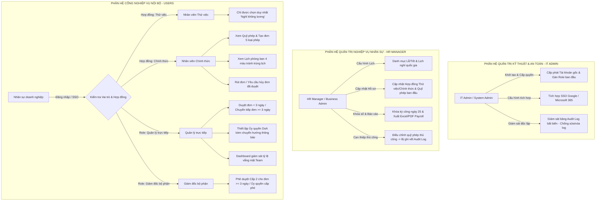
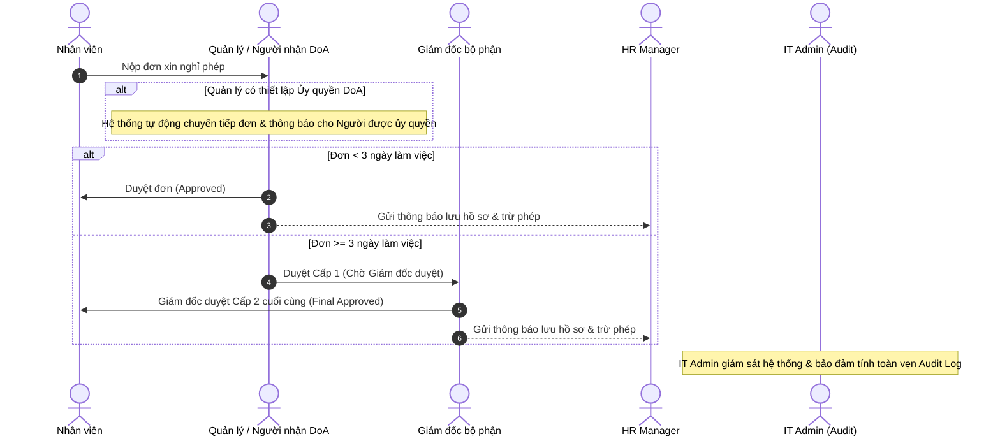

# TÀI LIỆU ĐẶC TẢ YÊU CẦU PHẦN MỀM (SRS)
## DỰ ÁN: HỆ THỐNG QUẢN LÝ NGHỈ PHÉP NỘI BỘ (MINI HRM LEAVE PORTAL)
**Khách hàng / Doanh nghiệp:** Khối Doanh nghiệp, Quản trị Nhân sự & Phòng Công nghệ Thông tin  
**Môn học:** Đảm bảo Chất lượng Phần mềm (Software Quality Assurance)  
**Phiên bản:** 3.3 (Bản Hoàn thiện Phân tách Vai trò HR Manager & IT Admin - Separation of Duties)  
**Ngày ban hành:** 08/10/2026  

---

## 1. GIỚI THIỆU TỔNG QUAN (INTRODUCTION)

### 1.1. Mục đích tài liệu (Purpose)
Tài liệu này đặc tả chi tiết toàn bộ yêu cầu chức năng, yêu cầu phi chức năng, quy tắc nghiệp vụ (*Business Rules*), luồng phê duyệt đa cấp (*Multi-level Workflow*), cơ chế ủy quyền phê duyệt (*Delegation of Authority - DoA*), quản lý ngày Lễ/Tết, kiểm soát xung đột chốt kỳ công, và phân hệ kiểm toán độc lập (*Audit Trail*) cho **Hệ thống Quản lý Yêu cầu Nghỉ phép Nội bộ (Mini HRM Leave Portal)**.  
Đặc biệt, phiên bản 3.3 chuẩn hóa nguyên tắc **Phân tách Trách nhiệm (Separation of Duties - SoD)** giữa hai vai trò quản trị: **HR Manager (Business Admin)** và **IT Admin (System Admin)** nhằm bảo vệ tính toàn vẹn dữ liệu tiền lương và tính bất biến của Audit Log.  
Tài liệu làm căn cứ chuẩn (*Ground Truth / Baseline*) phục vụ công tác nghiệm thu và kiểm thử phần mềm SQA.

### 1.2. Phạm vi sản phẩm (Product Scope)
Hệ thống là nền tảng quản trị vắng mặt tập trung đa thiết bị (Web & Mobile Responsive PWA) gồm các phân hệ độc lập:
1. **Cổng Nghiệp vụ Nội bộ (HR Portal - URL: `/employee` & `/manager`):**
   - **Nhân viên (Employee):** Quản lý quỹ phép cá nhân, nộp đơn xin nghỉ linh hoạt (cả ngày / nửa ngày) theo quy chuẩn tối giản **4-Clicks**, theo dõi lịch phòng ban trực quan (**Team Visual Calendar** với 4 mã màu), rút đơn hoặc yêu cầu hủy đơn đã duyệt. Nhân sự thử việc chỉ được phép xin nghỉ không lương.
   - **Quản lý trực tiếp (Line Manager):** Xét duyệt đơn nghỉ của cấp dưới trực tiếp, thiết lập ủy quyền duyệt (**DoA**) khi đi vắng kèm cơ chế tự động chuyển hướng thông báo đơn mới, theo dõi Dashboard vắng mặt của nhóm.
   - **Giám đốc bộ phận (Head of Department / Director):** Phê duyệt cấp 2 cho các đơn xin nghỉ phép dài ngày ($\ge 3$ ngày làm việc) hoặc ủy quyền cho cấp phó.
2. **Cổng Quản trị Vận hành Nhân sự (HR Manager Portal - URL: `/admin`):**
   - **HR Manager (Business Admin):** Quản lý hồ sơ nhân sự, danh mục phòng ban, chức danh nghiệp vụ; cập nhật phân loại hợp đồng (*Thử việc / Chính thức*); cấu hình danh mục ngày Lễ/Tết quốc gia; điều chỉnh quỹ phép thủ công (bị ghi Audit Log); thực hiện chốt khóa sổ kỳ tính lương (**Payroll Cutoff Lock**) ngày 25 hàng tháng và trích xuất báo cáo tiền lương chuẩn **Excel (`.csv`/`.xlsx`)** & **PDF**.
3. **Cổng Quản trị Kỹ thuật & Giám sát An toàn (IT Admin Portal - URL: `/admin` & System Config):**
   - **IT Admin (System Admin):** Cấp phát tài khoản gốc khởi tạo, gán vai trò ban đầu, cấu hình tích hợp đăng nhập tập trung SSO (*Google Workspace / Microsoft 365*), quản lý server và hạ tầng.
   - **Giám sát chéo Audit Log:** Nắm toàn quyền quản lý, lưu trữ và bảo vệ tính bất biến của bảng **Audit Log**, đảm bảo không một ai (kể cả HR Manager) có thể xóa hoặc sửa lịch sử can thiệp dữ liệu. IT Admin tuyệt đối không tham gia duyệt đơn hay chốt công lương để đảm bảo tính khách quan.

### 1.3. Định nghĩa & Từ viết tắt (Definitions & Acronyms)
| Thuật ngữ | Diễn giải |
| :--- | :--- |
| **SRS** | Software Requirements Specification (Đặc tả yêu cầu phần mềm) |
| **Line Manager (LM)** | Quản lý trực tiếp (Người duyệt cấp 1 cho đơn nghỉ phép của nhóm) |
| **Head of Department (HoD)** | Giám đốc bộ phận / Trưởng khối (Người duyệt cấp 2 cho đơn dài ngày $\ge 3$ ngày) |
| **HR Manager** | Trưởng phòng / Chuyên viên Nhân sự cấp cao (Business Admin - Quản trị vận hành nhân sự & tiền lương) |
| **IT Admin** | Quản trị viên Kỹ thuật & An toàn Thông tin (System Admin - Quản trị tài khoản gốc, SSO & giám sát Audit Log) |
| **SoD (Separation of Duties)**| Nguyên tắc phân tách nhiệm vụ giữa vận hành nghiệp vụ (HR) và kiểm soát hệ thống kỹ thuật (IT Admin) |
| **DoA (Delegation of Authority)**| Cơ chế ủy quyền phê duyệt tạm thời cho nhân sự chỉ định khi người duyệt vắng mặt kèm tự động chuyển hướng thông báo |
| **Payroll Lock** | Mốc khóa sổ kỳ tính lương (ngày 25 hàng tháng), chặn hoàn toàn việc nộp đơn lùi ngày vào kỳ đã chốt |
| **Public Holidays** | Danh mục các ngày Lễ/Tết quốc gia theo luật định (tự động loại trừ, không trừ phép năm) |
| **Probationary Employee** | Nhân sự đang thử việc (chỉ được xin nghỉ không hưởng lương) |
| **Accrual & Carry-over** | Tích lũy phép định kỳ (+1 ngày/tháng) và chuyển phép năm cũ (hết hạn 23:59:59 ngày 31/03) |
| **Audit Log Trail** | Nhật ký kiểm toán bất biến (Append-only) ghi lại toàn bộ thao tác can thiệp dữ liệu hệ thống |

---

## 2. TÁC NHÂN & MA TRẬN PHÂN QUYỀN (ACTORS & ROLES)

### 2.1. Ma trận phân quyền chi tiết (RBAC Matrix)

| Chức năng hệ thống | Nhân viên Thử việc | Nhân viên Chính thức | Quản lý trực tiếp (LM) | Giám đốc bộ phận (HoD) | HR Manager (Business Admin) | IT Admin (System Admin) |
| :--- | :---: | :---: | :---: | :---: | :---: | :---: |
| **Đăng nhập hệ thống (Mật khẩu / SSO)** | ✅ | ✅ | ✅ | ✅ | ✅ | ✅ (Tài khoản gốc) |
| **Xem số dư phép & Lịch sử cá nhân** | ❌ (Chưa có phép) | ✅ Cá nhân | ✅ Cá nhân | ✅ Cá nhân | ✅ Toàn công ty | ❌ (Không dùng portal) |
| **Tạo đơn xin nghỉ phép** | ⚠️ Chỉ Nghỉ không lương | ✅ Đầy đủ 5 loại phép | ✅ Đầy đủ 5 loại phép | ✅ Đầy đủ 5 loại phép | ❌ (Không tự tạo đơn)| ❌ (Không duyệt/xin nghỉ) |
| **Xem Lịch vắng mặt phòng ban (4 màu)**| ✅ Team mình | ✅ Team mình | ✅ Team mình | ✅ Toàn bộ phận | ✅ Toàn công ty | ❌ (Không tham gia) |
| **Thiết lập Ủy quyền duyệt DoA** | ❌ Chặn | ❌ Chặn | ✅ Được ủy quyền | ✅ Được ủy quyền | ❌ Chặn | ❌ Chặn |
| **Duyệt đơn nghỉ phép $< 3$ ngày** | ❌ Chặn | ❌ Chặn | ✅ Duyệt (hoặc DoA) | ✅ Duyệt cấp dưới | ❌ Chặn (Không duyệt đơn)| ❌ Chặn |
| **Duyệt đơn nghỉ phép $\ge 3$ ngày** | ❌ Chặn | ❌ Chặn | ✅ Duyệt Cấp 1 | ✅ Duyệt Cấp 2 (Final) | ❌ Chặn (Không duyệt đơn)| ❌ Chặn |
| **Xác nhận yêu cầu hủy đơn đã duyệt** | ❌ Chặn | ❌ Chặn | ✅ Quản lý xác nhận | ✅ Giám đốc xác nhận | ❌ Chặn | ❌ Chặn |
| **Khởi tạo tài khoản gốc & Gán Role** | ❌ Chặn | ❌ Chặn | ❌ Chặn | ❌ Chặn | ❌ Chặn | ✅ **Toàn quyền IT Admin** |
| **Cập nhật Hợp đồng (Thử việc/Chính thức)**| ❌ Chặn | ❌ Chặn | ❌ Chặn | ❌ Chặn | ✅ **Toàn quyền HR** | ❌ Chặn |
| **Cấu hình Danh mục Lễ/Tết quốc gia** | ❌ Chặn | ❌ Chặn | ❌ Chặn | ❌ Chặn | ✅ **Toàn quyền HR** | ❌ Chặn |
| **Điều chỉnh Quỹ phép thủ công** | ❌ Chặn | ❌ Chặn | ❌ Chặn | ❌ Chặn | ⚠️ **Có quyền (Bị ghi Log)**| ❌ Chặn |
| **Khóa sổ kỳ công ngày 25 & Xuất Excel/PDF**| ❌ Chặn | ❌ Chặn | ❌ Chặn | ❌ Chặn | ✅ **Toàn quyền HR** | ❌ Chặn |
| **Giám sát & Quản trị bảng Audit Log** | ❌ Chặn | ❌ Chặn | ❌ Chặn | ❌ Chặn | 👁️ Chỉ xem lịch sử | ✅ **Toàn quyền Giám sát**|
| **Cấu hình tích hợp SSO & Hạ tầng Server**| ❌ Chặn | ❌ Chặn | ❌ Chặn | ❌ Chặn | ❌ Chặn | ✅ **Toàn quyền IT Admin** |

---

## 3. YÊU CẦU CHỨC NĂNG CHI TIẾT (FUNCTIONAL REQUIREMENTS)

### PHÂN HỆ I: QUẢN LÝ QUỸ PHÉP & DANH MỤC LỄ/TẾT (HR MANAGER)

#### FR-01: Quản lý Danh mục Ngày Lễ, Tết Quốc gia (Public Holidays Management)
- **Người thực hiện:** HR Manager.
- **Mô tả:** Thiết lập danh mục các ngày Lễ/Tết quốc gia trong năm (Tết Dương lịch, Tết Nguyên đán, Giỗ Tổ 10/3, 30/4 - 1/5, Quốc khánh 2/9,...).
- **Quy tắc tính toán:**
  - Hệ thống **tự động loại trừ các ngày Lễ/Tết đó** cùng với Thứ 7 và Chủ Nhật khi tính số ngày làm việc bị trừ phép (theo **BR-05**).
  - *Ví dụ:* Nghỉ từ Thứ 4 ngày 29/04 đến Thứ 2 ngày 04/05 (30/04 và 01/05 là ngày Lễ, Thứ 7 & CN là cuối tuần): Hệ thống chỉ tính trừ **2.0 ngày phép năm**.

#### FR-02: Quản lý Vòng đời Tài khoản & Ràng buộc Nhân sự Thử việc (Separation of Account Lifecycle & Probation)
- **Quy trình phân tách hai giai đoạn (Separation of Account Creation & HR Onboarding):**
  1. *Bước 1 (IT Admin):* Khi có nhân sự mới gia nhập, IT Admin là người khởi tạo tài khoản hệ thống (Email công ty `@company.vn`, Mật khẩu khởi tạo) và gán vai trò ban đầu (`Role: EMPLOYEE` hoặc `MANAGER`).
  2. *Bước 2 (HR Manager):* Sau khi tài khoản được cấp phát, HR Manager truy cập màn hình Hồ sơ nhân sự để cập nhật loại hợp đồng: `Thử việc (Probation)` hoặc `Chính thức (Official)`, chức danh thực tế, phòng ban và cấp hạn mức quỹ phép ban đầu.
- **Ràng buộc tạo đơn đối với Nhân sự Thử việc:**
  - Trong giai đoạn thử việc, form tạo đơn **chỉ hiển thị duy nhất 01 lựa chọn "Nghỉ không hưởng lương" (Unpaid Leave)** theo **BR-02**. Toàn bộ các tùy chọn phép hưởng lương bị ẩn hoàn toàn.
  - Khi HR cập nhật trạng thái hợp đồng sang "Chính thức", hệ thống tự động kích hoạt đầy đủ 5 loại phép và bắt đầu cộng dồn ngày phép định kỳ.

#### FR-03: Cơ chế Tích lũy phép hàng tháng & Thưởng thâm niên (Accrual & Seniority Policy)
- **Tích lũy định kỳ (Monthly Accrual):** Đúng ngày 01 hàng tháng, mỗi nhân sự chính thức được tự động cộng **+1.0 ngày phép năm** vào tài khoản cá nhân.
- **Thưởng thâm niên (Seniority Bonus):** Cứ làm việc đủ **03 năm liên tục**, nhân sự được cộng thêm **+1 ngày phép/năm** (Thâm niên 3 năm = 13 ngày/năm; 6 năm = 14 ngày/năm,...).

#### FR-04: Chính sách Chuyển phép năm cũ & Hạn chót 31/03 (Carry-over Policy)
- Phép năm cũ chưa sử dụng hết được chuyển sang năm mới và có giá trị sử dụng đến hết **23:59:59 ngày 31 tháng 03**.
- Đúng 00:00 ngày 01/04, hệ thống tự động quét và xóa toàn bộ số ngày phép năm cũ còn dư về 0.
- Ưu tiên cấn trừ phép năm cũ trước khi nhân viên xin nghỉ trong Quý 1.

#### FR-05: Điều chỉnh Quỹ phép Thủ công & Kiểm soát Chéo qua Audit Log (Manual Adjustment & SoD Audit Trail)
- **Thao tác nghiệp vụ:** Chỉ HR Manager mới có quyền điều chỉnh số ngày phép thủ công cho nhân viên khi có sai sót hoặc theo quyết định đặc biệt của Ban Giám đốc.
- **Yêu cầu bắt buộc:** Bắt buộc nhập lý do giải trình ($\ge 5$ ký tự). Hệ thống tự động ghi nhật ký **Audit Log** bất biến: *Người thực hiện (AdminID/HR), Thời điểm, Nhân sự can thiệp, Số dư cũ, Số dư mới, Lý do điều chỉnh, Địa chỉ IP*.
- **Kiểm soát chéo (Cross-oversight):** HR Manager chỉ có quyền xem nhật ký kiểm toán, **tuyệt đối không có quyền sửa hoặc xóa bất kỳ dòng nào trong bảng Audit Log**. Quyền giám sát tính bất biến của bảng log thuộc về IT Admin.

---

### PHÂN HỆ II: QUY TRÌNH XIN VÀ DUYỆT PHÉP (WORKFLOW & DELEGATION)

#### FR-06: Cơ chế Ủy quyền Duyệt đơn & Tự động Chuyển hướng Thông báo (DoA & Notification Routing)
- **Mục đích:** Đảm bảo luồng phê duyệt không bị tắc nghẽn khi Quản lý trực tiếp hoặc Giám đốc đi công tác hoặc nghỉ phép dài ngày.
- **Thiết lập ủy quyền:** Quản lý chọn người nhận ủy quyền (cùng cấp hoặc cấp phó), khoảng thời gian (*Từ ngày - Đến ngày*), lý do ủy quyền.
- **Vòng đời thông báo DoA (DoA Notification Lifecycle):**
  1. *Thông báo kích hoạt tức thì:* Ngay khi tạo ủy quyền thành công, hệ thống tự động phát email và thông báo real-time ngay lập tức cho Người được ủy quyền để họ nắm bắt trách nhiệm.
  2. *Tự động chuyển hướng thông báo đơn mới (Notification Redirection):* Trong suốt thời gian DoA có hiệu lực, 100% thông báo *"Có đơn xin nghỉ mới"* từ cấp dưới sẽ tự động được chuyển hướng (route) thẳng đến hộp thư và chuông thông báo của Người nhận ủy quyền (kèm CC cho người ủy quyền theo dõi).
  3. *Thẩm quyền & Ghi nhận:* Người nhận ủy quyền có đầy đủ thẩm quyền Duyệt / Từ chối thay thế. Hệ thống gắn nhãn rõ ràng: *"Được phê duyệt bởi [Người B] theo ủy quyền của [Người A]"* và ghi vào Audit Log.
  4. *Kết thúc/Thu hồi ủy quyền:* Khi hết hạn hoặc khi người ủy quyền thu hồi trước hạn, hệ thống phát thông báo hoàn trả quyền hạn và thông báo về lại cho người ủy quyền ban đầu.

#### FR-07: Linh hoạt Chứng từ Y tế cho Nghỉ ốm (Flexible Sick Leave Attachment)
- Nghỉ ốm **dưới 2.0 ngày làm việc (0.5 hoặc 1.0 ngày):** Không bắt buộc nộp chứng từ y tế (Tùy chọn - Optional).
- Nghỉ ốm **từ 2.0 ngày làm việc trở lên:** **Bắt buộc 100%** phải đính kèm tệp chứng từ y tế hợp lệ (Giấy khám bệnh, Giấy ra viện có dấu đỏ, định dạng PDF/Ảnh $\le 5.0$ MB) theo **BR-08**.

#### FR-08: Ràng buộc Nộp đơn Lùi ngày & Khóa Kỳ công ngày 25 (Payroll Cutoff Lock Conflict Resolution)
- Cho phép nộp đơn lùi ngày tối đa **03 ngày làm việc** (theo **BR-07**), nhưng **tuyệt đối không được vượt qua mốc thời gian của kỳ công đã khóa**:
  - Hàng tháng, đúng ngày 25, HR Manager thực hiện thao tác **"Khóa sổ kỳ tính lương"** (kỳ từ ngày 26 tháng trước đến 25 tháng này).
  - Sau khi kỳ công đã khóa: Mọi hành vi tạo đơn lùi ngày vào các ngày thuộc kỳ công đã khóa ($\le 25$) sẽ bị **hệ thống từ chối và chặn ngay lập tức**.
  - Mọi yêu cầu hủy đơn đã duyệt thuộc kỳ công đã khóa cũng bị khóa để đảm bảo số liệu tính lương trong file Excel/PDF đã xuất không bị sai lệch.

#### FR-09: Quy trình Rút đơn (Recall) & Yêu cầu Hủy đơn đã duyệt
- **Rút đơn chưa duyệt (Pending):** Nhân viên được phép bấm nút "Rút đơn" trực tiếp, đơn chuyển sang `ĐÃ HỦY` ngay lập tức.
- **Hủy đơn đã duyệt (Approved):** Nhân viên tạo "Yêu cầu hủy phép đã duyệt" $\rightarrow$ Quản lý trực tiếp (hoặc người được ủy quyền) xác nhận thì hệ thống mới hoàn trả số ngày phép. (Chỉ áp dụng cho các ngày chưa bị khóa kỳ công).

---

### PHÂN HỆ III: LỊCH PHÒNG BAN & BẢNG ĐIỀU KHIỂN (CALENDAR & DASHBOARD)

#### FR-10: Lịch nghỉ phòng ban trực quan (Team Visual Calendar)
- Hiển thị lưới tháng Google Calendar với 4 mã màu chuẩn:
  - 🟢 **Xanh lá (Present):** Có mặt đi làm.
  - 🔴 **Đỏ (On Leave):** Nghỉ phép cả ngày.
  - 🟡 **Vàng (Half-day):** Nghỉ nửa ngày (sáng/chiều).
  - 🔵 **Xanh dương (Public Holiday):** Ngày Lễ/Tết quốc gia.
- Giúp nhân viên tránh nộp đơn trùng lịch cao điểm với đồng nghiệp trong cùng một dự án.

#### FR-11: Dashboard Phân tích Vắng mặt (Analytics Dashboard)
- **Dashboard Quản lý:** Số lượng thành viên vắng mặt hôm nay, đơn chờ duyệt (kể cả đơn nhận qua ủy quyền DoA), tỷ lệ vắng mặt trong tháng của team.
- **Dashboard HR Manager:** Phân bố loại hình nghỉ phép toàn công ty, tỷ lệ vắng mặt theo phòng ban, cảnh báo vắng mặt vượt ngưỡng an toàn ($> 20\%$).

---

### PHÂN HỆ IV: BÁO CÁO TIỀN LƯƠNG & QUẢN TRỊ KỸ THUẬT

#### FR-12: Chốt kỳ công ngày 25 & Xuất Báo cáo Tiền lương (HR Manager)
- Mặc định kỳ công từ **ngày 26 tháng trước đến ngày 25 tháng hiện tại**.
- HR Manager kiểm tra số liệu, bấm **"Khóa sổ kỳ công"** $\rightarrow$ Kích hoạt trạng thái `Locked`.
- **Xuất Excel (`.csv` / `.xlsx`):** Bảng tổng hợp chi tiết từng nhân sự: Mã NV, Họ tên, Phòng ban, Chức danh, Công chuẩn (22), Số ngày phép năm, Số ngày nghỉ không lương (giảm trừ lương), Nghỉ ốm BHXH, Công thực tế.
- **Xuất PDF (`.pdf`):** Báo cáo chuẩn hóa phục vụ Ban Giám đốc và Kế toán ký duyệt.

#### FR-13: Quản trị Tài khoản Gốc, SSO & Giám sát An toàn (IT Admin)
- Cấp phát tài khoản gốc, quản lý hạ tầng và kết nối SSO Google / Microsoft 365.
- Giám sát bảo mật, lưu trữ bảng Audit Log trên hệ thống lưu trữ phân tán hoặc cơ chế bảo vệ quyền root/DB để không ai có thể can thiệp sửa đổi trái phép.

---

## 4. BẢNG 15 QUY TẮC NGHIỆP VỤ CỐT LÕI (CORE BUSINESS RULES - BR)

### BR-01: Quỹ phép năm & Công thức khả dụng (Annual Leave Balance Rule)
- $\text{Số phép khả dụng} = \text{Phép tích lũy năm nay} + \text{Phép tồn năm cũ (nếu còn hạn)} - \text{Đã duyệt}$.
- Đơn xin nghỉ phép năm bắt buộc $\text{Số ngày nghỉ} \le \text{Số phép khả dụng}$. Quỹ phép không được âm ($< 0$).

### BR-02: Ràng buộc Nhân sự Thử việc (Probationary Employee Constraint)
- Nhân sự trong giai đoạn thử việc **chỉ được phép tạo đơn "Nghỉ không hưởng lương" (Unpaid Leave)**. Toàn bộ các tùy chọn phép hưởng lương khác bị khóa hoàn toàn.
- Ngày phép năm chỉ bắt đầu được tích lũy từ tháng ký hợp đồng chính thức (+1.0 ngày/tháng).

### BR-03: Thưởng thâm niên (Seniority Bonus Rule)
- Cứ đủ **03 năm làm việc liên tục** tính từ ngày gia nhập, quỹ phép năm của nhân sự được tăng vĩnh viễn thêm **+1.0 ngày/năm**.

### BR-04: Hạn chót chuyển phép 31/03 (Carry-over Expiry Rule)
- Phép năm cũ chuyển sang năm mới có giá trị sử dụng đến hết 23:59:59 ngày **31 tháng 03**.
- Đúng 00:00 ngày 01 tháng 04, hệ thống tự động xóa toàn bộ số ngày phép năm cũ còn dư về 0.

### BR-05: Loại trừ Ngày cuối tuần & Ngày Lễ, Tết (Weekend & Public Holidays Exclusion Rule)
- Hệ thống **tự động loại trừ Thứ 7, Chủ Nhật VÀ tất cả các ngày Lễ/Tết quốc gia** có trong danh mục hệ thống khi tính số ngày nghỉ thực tế.
- Các ngày Lễ/Tết nằm trong khoảng thời gian nghỉ phép năm không bị tính vào số ngày khấu trừ quỹ phép.

### BR-06: Đơn vị nghỉ nửa ngày (Half-day Leave Rule)
- Nghỉ nửa ngày (`0.5 ngày`, sáng hoặc chiều) **chỉ được phép chọn khi `Từ ngày == Đến ngày`** (trong cùng 1 ngày duy nhất).

### BR-07: Ràng buộc Nộp đơn lùi ngày & Khóa kỳ công (Backdated Leave & Payroll Lock Rule)
- Cho phép nộp đơn lùi về quá khứ tối đa **03 ngày làm việc**, **NHƯNG tuyệt đối không được vượt qua mốc thời gian của kỳ công đã khóa (Payroll Locked)**.
- Mọi đơn có ngày nghỉ nằm trong kỳ công đã khóa (trước hoặc vào ngày 25 của kỳ đã chốt) sẽ bị từ chối ngay lập tức.

### BR-08: Linh hoạt Chứng từ Y tế (Sick Leave Attachment Threshold Rule)
- Nghỉ ốm **dưới 2.0 ngày làm việc (0.5 hoặc 1.0 ngày):** Tùy chọn nộp chứng từ (Không bắt buộc).
- Nghỉ ốm **từ 2.0 ngày làm việc trở lên:** **Bắt buộc 100%** phải đính kèm tệp chứng từ y tế hợp lệ ($\le 5.0$ MB).

### BR-09: Phê duyệt Đa cấp theo Thời lượng (Multi-level Approval Threshold)
- **Thời lượng $< 3.0$ ngày làm việc:** 01 cấp duyệt (Quản lý trực tiếp hoặc Người được ủy quyền DoA).
- **Thời lượng $\ge 3.0$ ngày làm việc:** 02 cấp duyệt (Quản lý trực tiếp duyệt Cấp 1 $\rightarrow$ Giám đốc bộ phận duyệt Cấp 2).

### BR-10: Cơ chế Ủy quyền Duyệt đơn & Chuyển hướng Thông báo (DoA & Notification Routing Rule)
- Khi Quản lý A thiết lập DoA cho Quản lý B còn hiệu lực, quyền phê duyệt đơn VÀ luồng nhận thông báo đơn mới được chuyển giao hợp lệ cho Người được ủy quyền B.
- Hệ thống bắt buộc gửi thông báo kích hoạt DoA tức thời cho B ngay khi A tạo ủy quyền.
- Trong thời gian DoA có hiệu lực, 100% thông báo "Có đơn xin nghỉ mới" phát sinh từ cấp dưới của A bắt buộc phải được chuyển hướng (route) tự động đến hộp thư và chuông thông báo của B (kèm CC cho A).
- Mọi thao tác phê duyệt của B đều ghi nhận rõ danh tính người thực hiện thực tế và cơ sở ủy quyền trong Audit Log. Khi hết hạn ủy quyền, quyền duyệt và luồng thông báo tự động hoàn trả về cho A.

### BR-11: Vòng đời Hủy đơn (Recall & Cancellation Rule)
- Đơn `CHỜ DUYỆT`: Nhân viên được phép bấm Rút đơn (Recall) trực tiếp.
- Đơn `ĐÃ DUYỆT`: Bắt buộc tạo Yêu cầu hủy và phải được Quản lý trực tiếp xác nhận mới hoàn phép.

### BR-12: Lý do bắt buộc khi Từ chối (Rejection Reason Rule)
- Người duyệt khi bấm Từ chối bắt buộc phải nhập lý do giải trình tối thiểu **10 ký tự trở lên**.

### BR-13: Chống trùng lịch nghỉ cá nhân (Overlapping Leave Rule)
- Chặn không cho phép tạo đơn giao thoa với khoảng thời gian của bất kỳ đơn nào trước đó đang ở trạng thái `CHỜ DUYỆT` hoặc `ĐÃ DUYỆT`.

### BR-14: Phân tách Cổng truy cập & Nguyên tắc Phân nhiệm (Portal Isolation & Separation of Duties - SoD)
- Đường dẫn `/admin/*` chỉ dành riêng cho tài khoản quản trị (`ADMIN`). Nhân viên và Quản lý truy cập sẽ bị trả mã lỗi `403 Forbidden`.
- **Nguyên tắc Phân nhiệm (SoD):** HR Manager nắm quyền vận hành nhân sự và điều chỉnh nghiệp vụ; IT Admin nắm quyền bảo mật hạ tầng và giám sát Audit Log. IT Admin không duyệt đơn hay chốt công; HR Manager không can thiệp server hay xóa sửa log.

### BR-15: Nhật ký Kiểm toán Bất biến & Giám sát Chéo (Immutable Audit Trail & Cross-Oversight Rule)
- Mọi thao tác điều chỉnh quỹ phép thủ công do HR Manager thực hiện đều bắt buộc phải nhập lý do và được lưu vào bảng Audit Log bất biến (thuộc tính Append-only, không thể chỉnh sửa hay xóa dòng).
- Bảng Audit Log được giám sát chéo bởi IT Admin để đảm bảo tính minh bạch và toàn vẹn dữ liệu tiền lương tuyệt đối.

---

## 5. MA TRẬN CHUYỂN ĐỔI TRẠNG THÁI ĐƠN NGHỈ PHÉP (STATE TRANSITION)

| Trạng thái hiện tại | Thao tác | Vai trò kích hoạt | Điều kiện / Ràng buộc | Trạng thái mới |
| :--- | :--- | :--- | :--- | :---: |
| *(Khởi tạo)* | Gửi đơn mới ($< 3$ ngày) | Nhân viên | Hợp lệ, không vi phạm khóa kỳ công | `CHỜ DUYỆT` |
| *(Khởi tạo)* | Gửi đơn mới ($\ge 3$ ngày) | Nhân viên | Hợp lệ, không vi phạm khóa kỳ công | `CHỜ DUYỆT` *(Cấp 1)* |
| `CHỜ DUYỆT` | Rút đơn (Recall) | Nhân viên | Đơn chưa xử lý | `ĐÃ HỦY` |
| `CHỜ DUYỆT` | Duyệt đơn ($< 3$ ngày) | Quản lý / DoA | Khấu trừ quỹ phép | `ĐÃ DUYỆT` |
| `CHỜ DUYỆT` | Từ chối | Quản lý / DoA | Bắt buộc lý do $\ge$ 10 ký tự | `ĐÃ TỪ CHỐI` |
| `CHỜ DUYỆT` *(Cấp 1)* | Quản lý duyệt cấp 1 | Quản lý / DoA | Chuyển tiếp lên Giám đốc | `CHỜ GĐ DUYỆT` *(Cấp 2)* |
| `CHỜ GĐ DUYỆT` | Giám đốc duyệt cấp 2 | Giám đốc / Cấp phó ủy quyền | Khấu trừ quỹ phép chính thức | `ĐÃ DUYỆT` |
| `CHỜ GĐ DUYỆT` | Từ chối | Giám đốc | Bắt buộc lý do $\ge$ 10 ký tự | `ĐÃ TỪ CHỐI` |
| `ĐÃ DUYỆT` | Gửi yêu cầu hủy phép | Nhân viên | Đơn chưa thuộc kỳ công đã khóa | `CHỜ HỦY DUYỆT` |
| `ĐÃ DUYỆT` | Gửi yêu cầu hủy phép | Nhân viên | Đơn thuộc kỳ công đã khóa | ❌ **Bị chặn (Locked)** |
| `CHỜ HỦY DUYỆT` | Xác nhận hủy | Quản lý trực tiếp | Hoàn lại số ngày phép đã trừ | `ĐÃ HỦY` |
| `CHỜ HỦY DUYỆT` | Bác bỏ yêu cầu hủy | Quản lý trực tiếp | Giữ nguyên trạng thái đã duyệt | `ĐÃ DUYỆT` |

---

## 6. YÊU CẦU PHI CHỨC NĂNG (NON-FUNCTIONAL REQUIREMENTS - NFR)

### NFR-01: Tương thích Di động Hoàn hảo (Mobile-First / Responsive PWA)
- Giao diện được tối ưu hiển thị 100% trên màn hình điện thoại thông minh (iOS Safari, Android Chrome).
- Hỗ trợ nhân viên chụp ảnh trực tiếp giấy khám bệnh từ camera điện thoại để đính kèm vào đơn nghỉ ốm.

### NFR-02: Trải nghiệm Người dùng Tối giản (Quy tắc Tối đa 4-Clicks)
- Quy trình tạo đơn xin nghỉ phép được tinh giản tối đa: Từ lúc mở app/web đến khi nộp thành công không vượt quá **04 thao tác (clicks/taps)**:
  * *Click 1:* Chọn ngày trên lịch.
  * *Click 2:* Chọn loại phép & đơn vị nghỉ.
  * *Click 3:* Nhập lý do (hoặc chọn lý do nhanh gợi ý).
  * *Click 4:* Nhấn "Nộp đơn".

### NFR-03: Bảo mật & Nhật ký Kiểm toán (Security & Audit Trail Integrity)
- **Mã hóa:** Mật khẩu được băm bằng thuật toán Bcrypt (Salt rounds = 10). Mọi kết nối truyền tải đều bảo vệ qua HTTPS / TLS 1.3.
- **Audit Logging:** Toàn bộ can thiệp thay đổi quỹ phép của HR Manager được lưu trữ với các trường: `LogID, AdminID, TargetUserID, Action, OldValue, NewValue, Reason, Timestamp, IPAddress`. Bảng Audit Log có thuộc tính Append-only (chỉ ghi thêm, nghiêm cấm chỉnh sửa hoặc xóa).
- **Separation of Duties (SoD):** Phân định ranh giới rõ ràng: HR vận hành nghiệp vụ, IT Admin kiểm soát an toàn kỹ thuật và bảo vệ tính bất biến của log.

### NFR-04: Tích hợp Đăng nhập Tập trung SSO (Google / Microsoft 365 Integration)
- Hỗ trợ giao thức OAuth 2.0 / OpenID Connect để nhân viên đăng nhập trực tiếp bằng tài khoản Google Workspace công ty (`@company.vn`) hoặc Microsoft Office 365, do IT Admin cấu hình tích hợp.

---

## 7. DỮ LIỆU TÀI KHOẢN MẪU KIỂM THỬ (PRE-SEEDED TEST DATA)

| Vai trò | Email đăng nhập | Mật khẩu | Họ và tên | Chức danh & Phòng ban | Đặc điểm kiểm thử phân quyền (SoD) |
| :--- | :--- | :---: | :--- | :--- | :--- |
| **IT Admin (System Admin)**| `itadmin@company.vn` | `Pass@123` | Nguyễn Hoàng Bách | Chuyên viên An ninh & IT Admin | Khởi tạo tài khoản gốc, cấu hình SSO, giám sát bảo mật bảng Audit Log bất biến; không duyệt đơn, không chốt lương. |
| **HR Manager (Business Admin)**| `admin@company.vn` | `Pass@123` | Hoàng Thu Trang | Trưởng phòng Nhân sự | Quản lý hồ sơ nhân sự, phân loại hợp đồng, cấu hình Lễ/Tết, khóa sổ kỳ công ngày 25, xuất Excel/PDF, điều chỉnh quỹ phép (+ ghi Audit Log). |
| **Giám đốc bộ phận** | `director@company.vn` | `Pass@123` | Lê Khắc Hoàng | Giám đốc Khối Kỹ thuật | Phê duyệt cấp 2 cho đơn $\ge 3$ ngày; thiết lập ủy quyền cho cấp phó. |
| **Quản lý trực tiếp**| `mai.tran@company.vn` | `Pass@123` | Trần Thị Mai | Trưởng phòng Kỹ thuật | Phê duyệt đơn cấp 1 (< 3 ngày); thiết lập ủy quyền DoA khi đi công tác/nghỉ phép. |
| **Quản lý ủy quyền (DoA)**| `tuan.le@company.vn` | `Pass@123` | Lê Anh Tuấn | Phó phòng Kỹ thuật | Nhận ủy quyền duyệt đơn thay cho Trần Thị Mai trong thời gian chỉ định; nhận thông báo chuyển hướng. |
| **Nhân viên (Chính thức)** | `an.nguyen@company.vn` | `Pass@123` | Nguyễn Văn An | Kỹ sư phần mềm (Senior) | Hợp đồng chính thức, thâm niên 3 năm (+1 ngày phép), có phép tồn năm cũ trước hạn 31/03. |
| **Nhân viên (Thử việc)** | `linh.dang@company.vn` | `Pass@123` | Đặng Thùy Linh | Nhân viên Thử việc (Frontend) | Hợp đồng thử việc: Form chỉ hiển thị duy nhất tùy chọn "Nghỉ không hưởng lương" (BR-02). |
